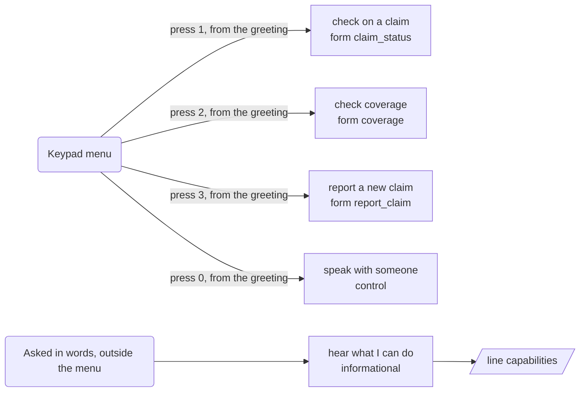
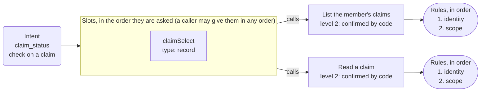
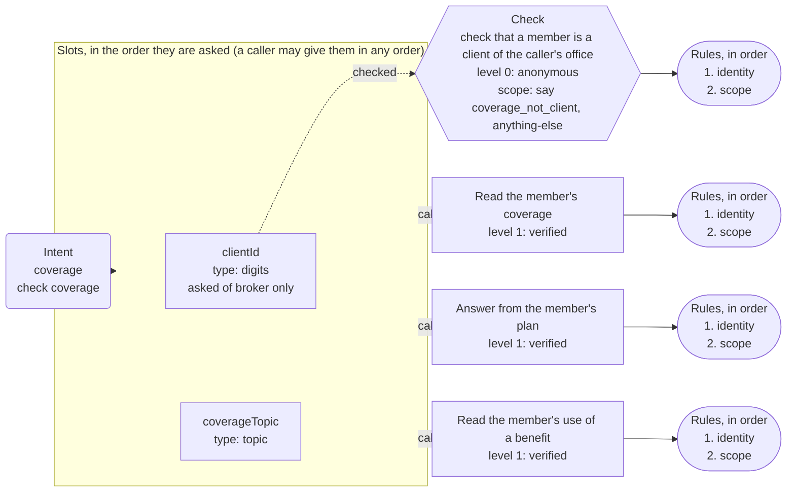
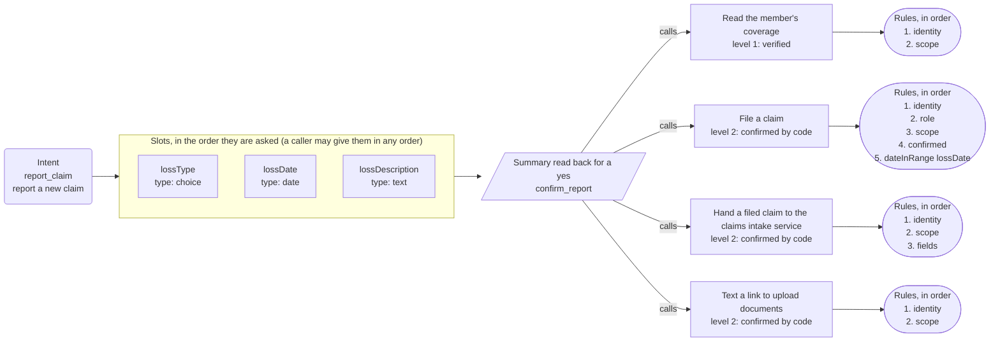

# App map: Harbor Mutual

*Generated from the app's configuration by `pnpm app:diagram`: do not edit it by hand. A test fails when this page and the configuration disagree.*

**This is the structure of the app, not a script for a call.** The dialog is mixed-initiative: a caller may give details in any order, change their mind, answer two questions at once or ask for two things in a row, and the engine follows. The map shows what is connected to what.

## What a caller can ask for

| Intent | Kind | Said as | What happens |
| --- | --- | --- | --- |
| `claim_status` | form | check on a claim | opens the form, which asks for claim |
| `coverage` | form | check coverage | opens the form, which asks for member ID (of broker only), coverage topic |
| `report_claim` | form | report a new claim | opens the form, which asks for kind of loss, date of loss, what happened |
| `capabilities` | informational | hear what I can do | says "I'm an automated assistant, but you can talk to me naturally. I can tell you the status..." and goes back to the question |
| `agent` | control | speak with someone | handled by the engine |
| `repeat_prompt` | control | hear that again | handled by the engine |
| `done` | control | finish up | handled by the engine |
| `other` | control | something else | handled by the engine |
| `none` | control | nothing | handled by the engine |

## The keypad menu and the lines that are only said

## Claim status

Intent `claim_status` to its slots, the summary, the action and its rules.

## Coverage question

Intent `coverage` to its slots, the summary, the action and its rules.

## Report a claim

Intent `report_claim` to its slots, the summary, the action and its rules.

## Dangling references

None: every intent reaches a form or a line, and every action is reached by a form or the identity flow.
