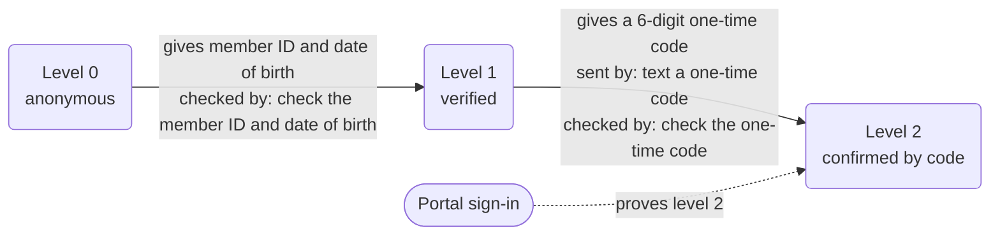
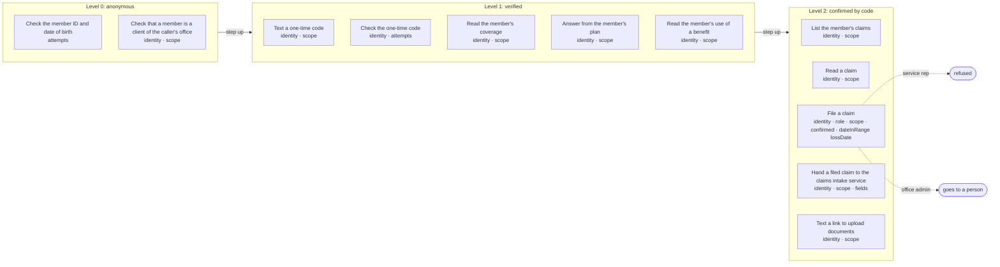

# Policy card: Harbor Mutual

*Generated from `policy.yaml` and `identity.yaml`, and the lines a model words from `prompts.yaml` and `forms.yaml`, by `pnpm policy:card`: do not edit it by hand. Change the files, write the card again, and review the diff. A test fails when this page and the files disagree.*

| File | Config hash |
| --- | --- |
| `policy.yaml` | `eeead42923cb2cc5f59569f771e73ba234f5901f3fd808b187595fd0658fdfe6` |
| `identity.yaml` | `221ca97b4ad23adb7467b5a3d822d758b684eb9f78af3f612ac10ee031f72c8a` |

The hash is a SHA-256 of the file's content (comments and layout do not change it); every call's audit record carries the hashes it ran under.

## Defaults

- Anything not listed under Actions is refused.
- The rules of an action run in the order shown, and the first one that fails decides.
- Identifiers in decision lines appear by their last four characters (`...1234`), never in full; a value recorded hidden, by length or never shows not even those.
- A caller has 3 tries at each identity check (the member ID and date of birth, and the one-time code). After that a person takes the call.
- In traces and the audit a caller's values are recorded as they are said, except: member ID by its last four; date of birth hidden (the trace keeps only its year, `••/••/1985`; a call as recorded, in the gate's decision, the console and the audit, shows `•`); what happened by its length.

## Identity

| Level | Name | What the caller gives | Checked by |
| --- | --- | --- | --- |
| 0 | anonymous | nothing | |
| 1 | verified | their member ID and date of birth | check the member ID and date of birth (`verifyMember`) |
| 2 | confirmed by code | level 1, and a 6-digit one-time code sent to the contact on file | text a one-time code (`sendCode`); check the one-time code (`verifyCode`) |

- Each level includes the one below it. A member below an action's level is asked for what the next level needs; any other caller is refused.
- The identity checks (check the member ID and date of birth, `verifyMember`; text a one-time code, `sendCode`; check the one-time code, `verifyCode`) are for members only: a caller not yet verified may use them, and any other party (one who acts for members, or anyone else) is refused them before their rules run.
- The one-time code is keyed on the keypad: it is masked, never traced and never held as a slot.
- A sign-in through a portal proves level 2 ('confirmed by code'), so a signed-in caller starts there.

Some tasks need a higher level before any action is called, even where the action itself needs less:

- Report a claim (`report_claim`) needs 'confirmed by code'.

## Who is served and who acts for them

- **member**: the people the app serves. They are verified up the ladder above and may see only their own records.
- **broker**: acts for members, signed in through a portal. They may see the records of the members they act for, with a role: service rep (`service_rep`), office admin (`office_admin`).

What each role may do. In the actions that have a role rule, a role the rule does not list is refused, and so is a party with no role. The last row is every action that has no role rule: every role, and a party with no role, goes ahead to its other rules (the level, whose record it is, the confirmation). The identity checks (check the member ID and date of birth, text a one-time code and check the one-time code) are for members only: a party who acts for them is refused those, whatever its role.

| Role | Goes ahead | Goes to a person | Refused |
| --- | --- | --- | --- |
| service rep (`service_rep`) | none | none | file a claim |
| office admin (`office_admin`) | none | file a claim | none |
| every role, and a party with no role | read the member's coverage answer from the member's plan check that a member is a client of the caller's office read the member's use of a benefit list the member's claims read a claim hand a filed claim to the claims intake service text a link to upload documents | none | check the member ID and date of birth text a one-time code check the one-time code |

## What is withheld

A party who acts for members does not see every field of what some actions return: right after the action runs, the engine sets these fields to nothing wherever the result holds them, at any depth, before a line, the session, the trace, the console or the audit reads it. The record of the call says which fields were withheld, and where the action's summary repeats what one held, that is masked. What the action itself does with the whole record as it runs is not covered: a side effect it queues goes to its service as queued (its record masks what was withheld), and what it writes to the session and an error it raises are its own; the action's code keeps those to what the caller may see. A row for a role replaces its kind's for that action, and a party of a kind with no row here at all (nor its role) sees none of the fields an action declares it may withhold. A member acting for themselves sees the whole of their own record.

| Who | Action | Fields withheld |
| --- | --- | --- |
| broker, any role | Read a claim (`getClaim`) | `diagnosis`, `statement` |
| broker, any role | List the member's claims (`listClaims`) | `diagnosis`, `statement` |
| broker, any role | File a claim (`createClaim`) | `diagnosis`, `statement` |
| broker, any role | Read the member's use of a benefit (`getUsage`) | `used` |

## What is recorded

What the record of a call keeps of each value the action is sent, where the action's call is recorded: the gate's decision, the trace, the console and the audit. A value is recorded as its slot says or as policy.yaml's `audit` declares, and `check` refuses one that neither covers. Where a rule's line, the action's summary, its own audit rows, the side effects it queues (as recorded) or a downstream service's row for the answer repeat a value that is hidden, shortened or never recorded, it is masked there too.

| Action | Value | Recorded |
| --- | --- | --- |
| Check the member ID and date of birth (`verifyMember`) | member ID (`memberId`) | by its last four characters |
| Check the member ID and date of birth (`verifyMember`) | date of birth (`dob`) | hidden (`•`) |
| Text a one-time code (`sendCode`) | member ID (`memberId`) | by its last four characters |
| Check the one-time code (`verifyCode`) | nothing | |
| Read the member's coverage (`getCoverage`) | member ID (`memberId`) | by its last four characters |
| Answer from the member's plan (`searchPolicy`) | member ID (`memberId`) | by its last four characters |
| Answer from the member's plan (`searchPolicy`) | topic (`topic`) | as it is |
| Check that a member is a client of the caller's office (`isClient`) | member ID (`clientId`) | by its last four characters |
| Read the member's use of a benefit (`getUsage`) | member ID (`memberId`) | by its last four characters |
| Read the member's use of a benefit (`getUsage`) | topic (`topic`) | as it is |
| List the member's claims (`listClaims`) | member ID (`memberId`) | by its last four characters |
| Read a claim (`getClaim`) | claim (`claim`) | as it is |
| File a claim (`createClaim`) | member ID (`memberId`) | by its last four characters |
| File a claim (`createClaim`) | kind of loss (`lossType`) | as it is |
| File a claim (`createClaim`) | date of loss (`lossDate`) | as it is |
| File a claim (`createClaim`) | what happened (`lossDescription`) | by its length only |
| Hand a filed claim to the claims intake service (`triageClaim`) | claim (`claim`) | as it is |
| Hand a filed claim to the claims intake service (`triageClaim`) | kind of loss (`lossType`) | as it is |
| Hand a filed claim to the claims intake service (`triageClaim`) | date of loss (`lossDate`) | as it is |
| Hand a filed claim to the claims intake service (`triageClaim`) | what happened (`lossDescription`) | by its length only |
| Text a link to upload documents (`sendUploadLink`) | claim (`claim`) | as it is |

The slots these values come from are recorded by their own redact setting (slots.yaml) wherever a call's slots are: the trace's slots, the variables of the lines that say them (a read-back among them), a handoff's data and the console. Where that is not what the table says:

- Hidden there but for the year in it at most (`••/••/1985`), in a side effect's request too: date of birth (`dob`).
- By its length there, and by its stand-in in its lines and a handoff's data; but, the caller's own words, shown as said on the live console while the call is in progress, a side effect's request there among them: what happened (`lossDescription`).

## Lines a model words

These lines say a knowledge base's approved passage, and may word it for the caller's question, on the topics marked `risk: low` in kb/topics.yaml only: on every other topic the passage is said word for word, as it always is. The model is sent the span's goal, its sentence (the line's own fixed words, the answer a gap), the approved passage as it would be said (the only facts it may state) and the caller's question in their own words (quoted, and screened again for an injection first): never the topic's account line (the caller's own data, said after the answer word for word, as after the passage), a record, another passage or the transcript. Each wording is checked by code before anyone hears it, for its data and shape: it names no number, amount, date or capitalized word the passage does not (the caller's question is no source of facts); it asks nothing; it copies no four words running of the line's own fixed words; and it keeps to its word budget (the passage's own word count, unless the span sets one) and avoids the phrases style.yaml lists. What it means is the drift judge's: the decision model, given the wording heard in its sentence, its goal, the passage and the question, refuses one that says anything other than what the passage says for that question (anything added, anything changed or turned around, or a condition, a limit or an exclusion that bears on the answer left out), at 0.5 or above (style.yaml's `judge.refuseAt`). The passage is said word for word whenever a check fails, the judge refuses, the model errs, or the wording and its checks are not done within RENDER_ANSWER_TIMEOUT_MS (4 s on a call and 6 s in a chat by default); once they run past a line's own budgets, the caller first hears the hold line ("One moment while I gather that information."). The knowledge record keeps the passage's id, version and approval and says whether the passage or a wording of it was said, and the audit's `kb_worded` row names the passage whose wording was. Every other line is said word for word.

| Line | Span | Goal | Words | Topics whose answer may be worded |
| --- | --- | --- | --- | --- |
| `coverage_answer` | `{answer}` | Answer the member's question from their plan's passage, in a sentence or two. | the passage's own word count | `sports_injury` (Sports injuries), `prescriptions` (Prescriptions), `travel` (Accidents while traveling), `filing_deadline` (Deadline to file a claim) |

No line is marked prescribed (`prescribed: true`).

## Actions

One row per action the agent may take. Anything else is refused.

| Action | Level | The gate checks, in order |
| --- | --- | --- |
| **Check the member ID and date of birth** `verifyMember` | 0 anonymous | 1. only a member, or a caller not yet verified, may use it (any other party is refused) 2. the identity check has not already failed 3 times (after that a person takes the call) |
| **Text a one-time code** `sendCode` | 1 verified | 1. only a member, or a caller not yet verified, may use it (any other party is refused) 2. the caller must be at 'verified' or above 3. the member ID must be the caller's own, or one they act for |
| **Check the one-time code** `verifyCode` | 1 verified | 1. only a member, or a caller not yet verified, may use it (any other party is refused) 2. the caller must be at 'verified' or above 3. the identity check has not already failed 3 times (after that a person takes the call) |
| **Read the member's coverage** `getCoverage` | 1 verified | 1. the caller must be at 'verified' or above 2. the member ID must be the caller's own, or one they act for |
| **Answer from the member's plan** `searchPolicy` | 1 verified | 1. the caller must be at 'verified' or above 2. the member ID must be the caller's own, or one they act for |
| **Check that a member is a client of the caller's office** `isClient` a form's check: the gate answers, nothing runs | 0 anonymous | 1. any caller may ask, verified or not 2. the member ID must be the caller's own, or one they act for |
| **Read the member's use of a benefit** `getUsage` | 1 verified | 1. the caller must be at 'verified' or above 2. the member ID must be the caller's own, or one they act for |
| **List the member's claims** `listClaims` | 2 confirmed by code | 1. the caller must be at 'confirmed by code' or above 2. the member ID must be the caller's own, or one they act for |
| **Read a claim** `getClaim` | 2 confirmed by code | 1. the caller must be at 'confirmed by code' or above 2. the claim must belong to the caller, or to someone they act for |
| **File a claim** `createClaim` | 2 confirmed by code | 1. the caller must be at 'confirmed by code' or above 2. by role: a service rep's request is refused; an office admin's request goes to a person (broker-filing); any other role, or none, is refused; a member acting for themselves is not held to this rule 3. the member ID must be the caller's own, or one they act for 4. the caller must confirm exactly these values at the read-back, and nothing else is sent: member ID, kind of loss, date of loss and what happened 5. the date of loss must be on or before today and inside the window `coverageWindow(memberId)` gives (a date out of bounds is refused; one outside the window goes to a person; anything that is not a date is refused); `coverageWindow` reads the member ID the scope rule above holds to the caller's own records, or those they act for |
| **Hand a filed claim to the claims intake service** `triageClaim` | 2 confirmed by code | 1. the caller must be at 'confirmed by code' or above 2. the claim must belong to the caller, or to someone they act for 3. only these fields are sent: `claim`, `lossType`, `lossDate`, `lossDescription` |
| **Text a link to upload documents** `sendUploadLink` | 2 confirmed by code | 1. the caller must be at 'confirmed by code' or above 2. the claim must belong to the caller, or to someone they act for |

### Actions by level, with their rules and what each role gets

