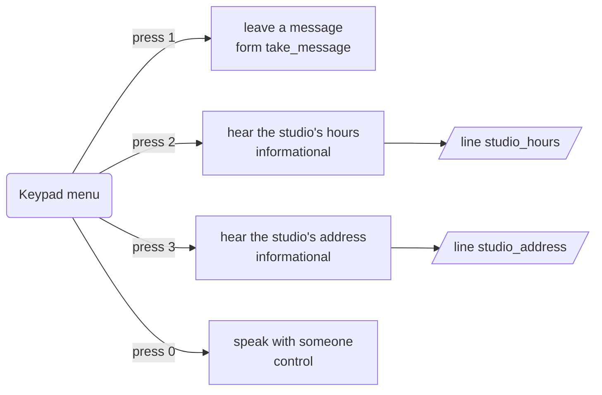
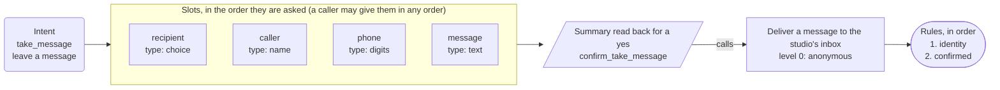
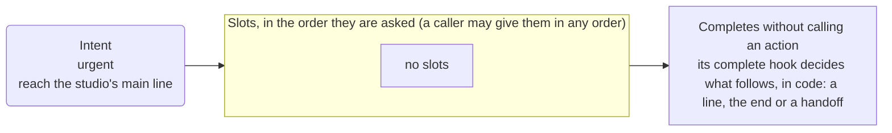
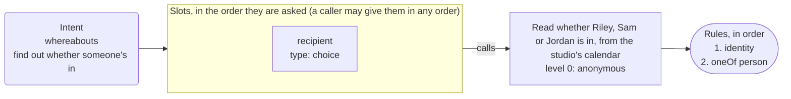
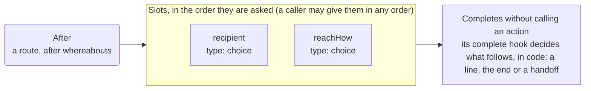
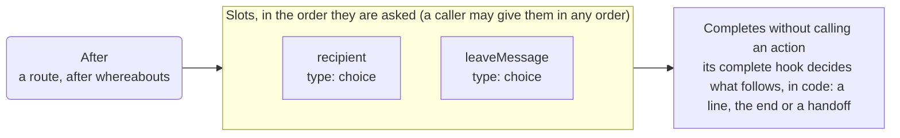
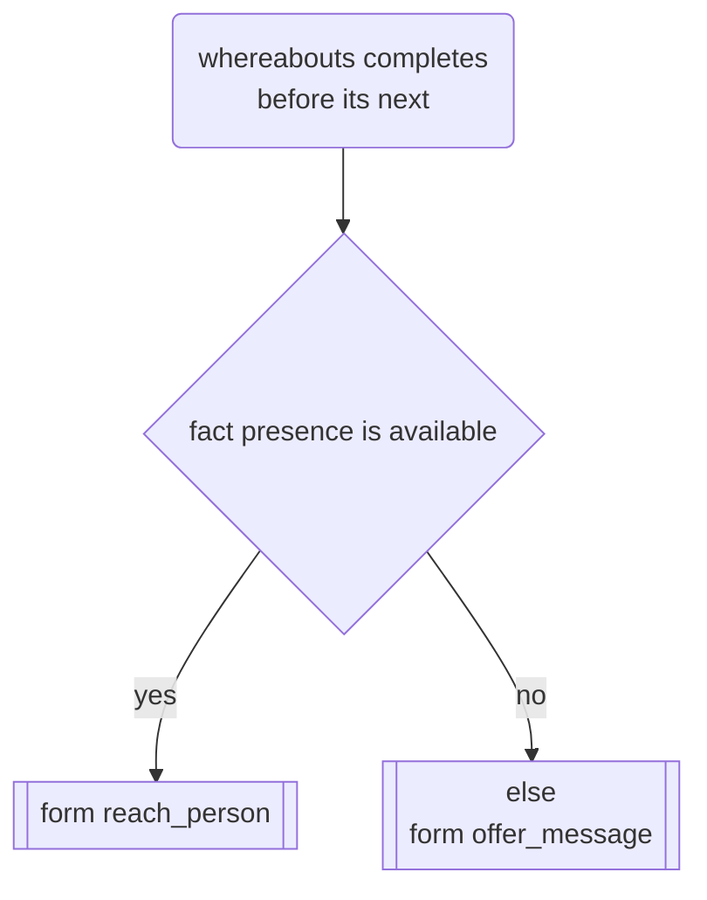
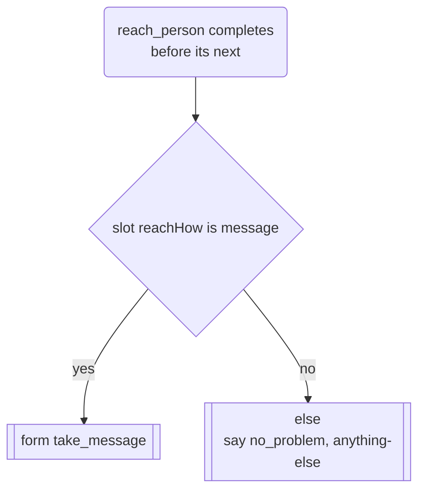
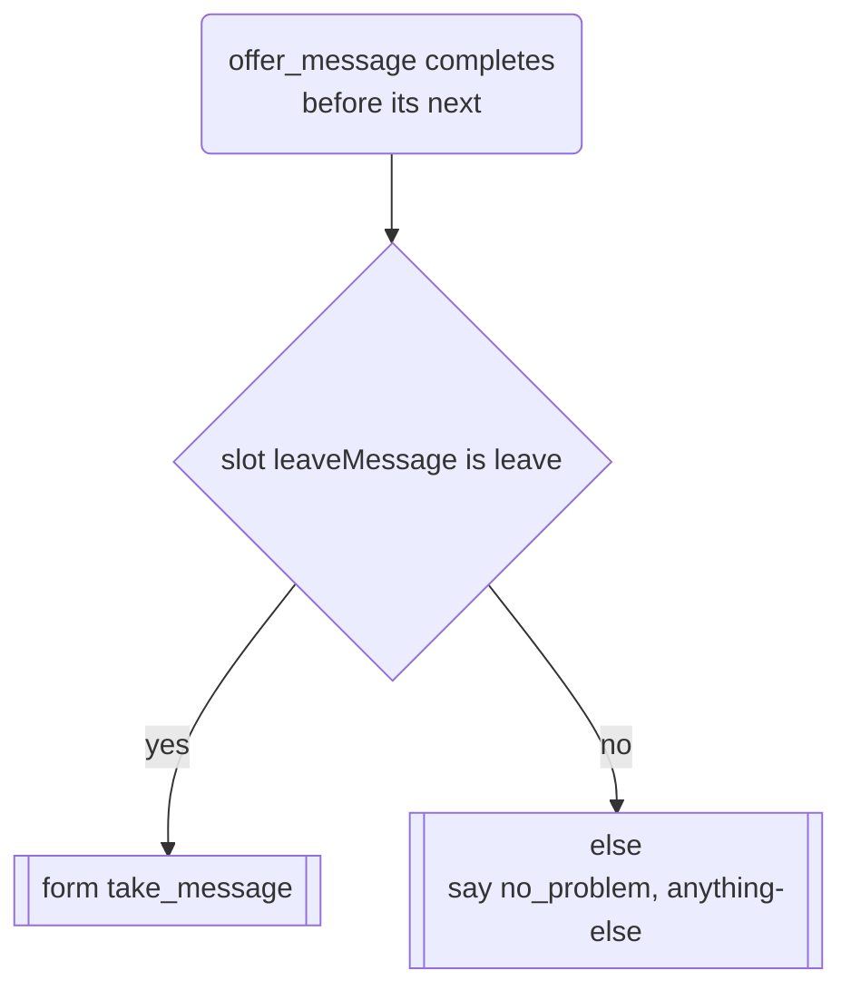
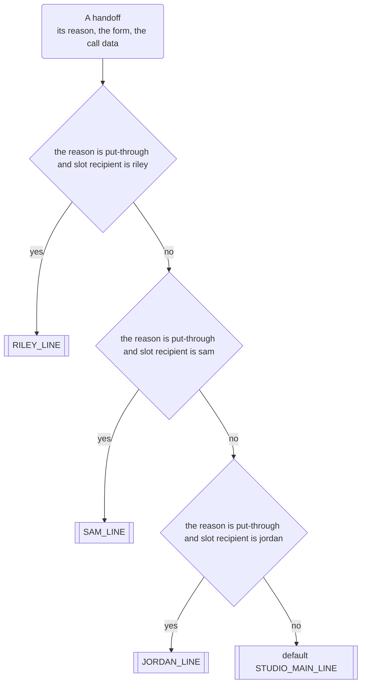

# App map: Example Front Desk

*Generated from the app's configuration by `pnpm app:diagram`: do not edit it by hand. A test fails when this page and the configuration disagree.*

**This is the structure of the app, not a script for a call.** The dialog is mixed-initiative: a caller may give details in any order, change their mind, answer two questions at once or ask for two things in a row, and the engine follows. The map shows what is connected to what.

## What a caller can ask for

| Intent | Kind | Said as | What happens |
| --- | --- | --- | --- |
| `take_message` | form | leave a message | opens the form, which asks for recipient, caller, phone, message |
| `urgent` | form | reach the studio's main line | opens the form, which asks for nothing |
| `studio_hours` | informational | hear the studio's hours | says "The studio is open weekdays, nine to five." and goes back to the question |
| `studio_address` | informational | hear the studio's address | says "The studio is at 418 Juniper Lane, Suite 2, in Example City." and goes back to the question |
| `whereabouts` | form | find out whether someone's in | opens the form, which asks for recipient |
| `agent` | control | speak with someone | handled by the engine |
| `repeat_prompt` | control | hear that again | handled by the engine |
| `done` | control | finish up | handled by the engine |
| `other` | control | something else | handled by the engine |
| `none` | control | nothing | handled by the engine |

## The keypad menu and the lines that are only said

## Take a message

Intent `take_message` to its slots, the summary, the action and its rules.

## Urgent, to the main line

Intent `urgent` to its slots, the summary, the action and its rules.

## Is someone in

Intent `whereabouts` to its slots, the summary, the action and its rules.

## Put through or a message

After a route (after whereabouts): the internal form `reach_person`, its slots, the summary, the action and its rules.

## Offer a message

After a route (after whereabouts): the internal form `offer_message`, its slots, the summary, the action and its rules.

## Routes

What the call does at its start, once the caller is verified, and after a form: the rules at each point are tried in order, the first whose conditions all hold is taken, and the else last. What the caller says still decides every other turn.

### After Is someone in

### After Put through or a message

### After Offer a message

## Where a handoff goes

The transfer targets, tried in order: the first whose conditions all hold is taken, else the default. Each dials the number or SIP address in its environment variable; the headers go only to a SIP address, the chat data only on a web chat.

## Dangling references

None: every intent reaches a form or a line, and every action is reached by a form or the identity flow.
