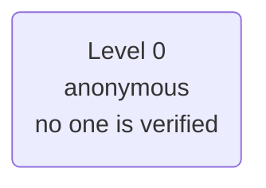
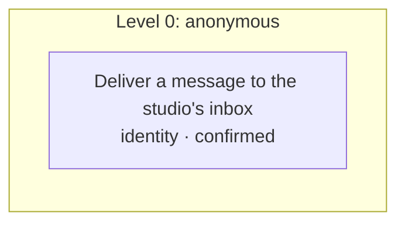

# Policy card: Example Front Desk

*Generated from `policy.yaml` and `identity.yaml`, and the lines a model words from `prompts.yaml` and `forms.yaml`, by `pnpm policy:card`: do not edit it by hand. Change the files, write the card again, and review the diff. A test fails when this page and the files disagree.*

| File | Config hash |
| --- | --- |
| `policy.yaml` | `dbf707447217d14d5718c65f09d67764e3e3145b0e729f051cffef139c105ecd` |
| `identity.yaml` | none: this app verifies no one |

The hash is a SHA-256 of the file's content (comments and layout do not change it); every call's audit record carries the hashes it ran under.

## Defaults

- Anything not listed under Actions is refused.
- The rules of an action run in the order shown, and the first one that fails decides.
- Identifiers in decision lines appear by their last four characters (`...1234`), never in full; a value recorded hidden, by length or never shows not even those.
- In traces and the audit a caller's values are recorded as they are said, except: phone by its last four; message by its length.

## Identity

This app verifies no one. Every caller stays anonymous (level 0), so every action is at level 0.

## Who is served and who acts for them

No one is verified, so the app has no subjects and no one acts for them.

## What is recorded

What the record of a call keeps of each value the action is sent, where the action's call is recorded: the gate's decision, the trace, the console and the audit. A value is recorded as its slot says or as policy.yaml's `audit` declares, and `check` refuses one that neither covers. Where a rule's line, the action's summary, its own audit rows, the side effects it queues (as recorded) or a downstream service's row for the answer repeat a value that is hidden, shortened or never recorded, it is masked there too.

| Action | Value | Recorded |
| --- | --- | --- |
| Deliver a message to the studio's inbox (`leaveMessage`) | recipient (`recipient`) | as it is |
| Deliver a message to the studio's inbox (`leaveMessage`) | caller (`caller`) | by its length only |
| Deliver a message to the studio's inbox (`leaveMessage`) | phone (`phone`) | by its last four characters |
| Deliver a message to the studio's inbox (`leaveMessage`) | message (`message`) | by its length only |

The slots these values come from are recorded by their own redact setting (slots.yaml) wherever a call's slots are: the trace's slots, the variables of the lines that say them (a read-back among them), a handoff's data and the console. Where that is not what the table says:

- Kept whole there, since the slot has no redact setting (policy.yaml's `audit` masks the value only in the action's call and the side effects it queues): caller (`caller`). A redact setting on the slot masks it there too.

## Lines a model words

These lines are fixed, but for the spans named (the framed form): a model words each span from the content it names, and nothing else of the line, whose fixed words say whose words the span gives. Each span is checked before anyone hears it: it asks nothing; it names no other value of the line's own items in their place; it adds no negation, and drops none from a clause of its content it restates; it leaves out no clause of its content that says "no" (a clause that is only an idiom, such as "no rush", aside) or sets a condition (unless, until before a clause, except, only if, as long as, provided), where the clause has two content words or more; it speaks as no one its content does not (the agent's own words, or words to the listener); it keeps to its word budget and avoids the phrases style.yaml lists; it names no number, amount, date or capitalized word its content does not; and the decision model, given the span, its goal and its content, finds it a faithful summary (nothing added or turned around, and no negated statement, refusal or condition, and no time, amount or who is to act, left out). A span worded as its content word for word is said unchanged, as the content. The content is screened for an injection again before a span is worded from it. When a check fails, the model is slow or errs, or the caller's words were flagged, the span is its content, word for word. The model is sent only the span's goal, its content (the caller's words, quoted), its word budget, the style, the channel and the language: never the line around it, an identity factor, a value the records hide whole (but a slot listed below as sent whole to be summarized), the transcript, or anything a tool returned. A line with a frame of its own for the exact words (`exactText`) is said with that frame whenever every span is its content word for word (no model, a fallback, a read-back after a no, a repeat), and with its text only when a span is generated. Every other line is said word for word.

| Line | Fixed text | Span | Goal | Generated | Worded from | Sent whole, though recorded masked | Words |
| --- | --- | --- | --- | --- | --- | --- | --- |
| `confirm_take_message` | Thanks, I'll make sure {recipient} gets your message: {caller}, on {phone}, called and said, in short, {summary}. Shall I pass it on? (said with a generated span; with every span its content word for word: I'll make sure {recipient} gets your message: {caller}, on {phone}, called and said: {summary}. Shall I pass it on?) | `{summary}` | Summarize the caller's message briefly, in their own terms, as a receptionist reading it back. | the first time it is said | `{message}`, a value the caller confirms | `{message}` | 20 |

Sent whole to the render model to summarize; masked in the records (a `text` slot's `redact: length-summarized`, the one exception to "never a value the records hide whole"):

| Slot | Summarized by | Recorded as |
| --- | --- | --- |
| `message` | `confirm_take_message` | by its length, in every record: the trace and the console (the slot, our lines that say it or its summary, with that part by its length), the audit, and a handoff (by its length, whatever app.yaml's handoff.data says) |

Its words go whole to the render model only for the span that summarizes them (a framed line's span worded from the slot; never a line generated whole from it, nor one that names it), and to the decision model's checks of that span: the content screened again for an injection, and the drift check, which is given the words as quoted. No other line is sent the caller's words. The app's own lines say them, and a tool is sent them. In such an app every caller's words are kept by their length: in the trace and on the console (the words of every turn, and the parts of them the model was asked about), and in the frame log, written before any turn has read them, which keeps none (a call of such an app cannot be replayed from it). The session store holds the words while the call is open, as it holds every slot's value.

Prescribed lines (`prescribed: true`): always said word for word, never generated.

| Line | Text |
| --- | --- |
| `handoff_frustrated` | Let me put you through to the studio's main line. |
| `handoff_live_agent` | One moment while I put you through to the studio's main line. |
| `handoff_max_attempts` | Let me put you through to the studio's main line to help with that. |
| `handoff_needs_human` | This one needs a person. Let me put you through to the studio's main line. |
| `handoff_result_unchecked` | I couldn't confirm your message was passed on, so let me put you through to the studio's main line. |
| `handoff_security` | Let me put you through to the studio's main line. |
| `handoff_system_failure` | I'm having trouble right now. Let me put you through to the studio's main line. |
| `handoff_urgent` | I'll put you straight through to the studio's main line. |
| `message_taken` | Your message is on its way to {recipient}. |

## Actions

One row per action the agent may take. Anything else is refused.

| Action | Level | The gate checks, in order |
| --- | --- | --- |
| **Deliver a message to the studio's inbox** `leaveMessage` | 0 anonymous | 1. any caller may ask, verified or not 2. the caller must confirm exactly these values at the read-back, and nothing else is sent: recipient, caller, phone and message (the read-back is generated and may summarize message; the values confirmed and sent are the ones kept, word for word, and the caller may ask to hear them so) |

### Actions by level, with their rules and what each role gets

