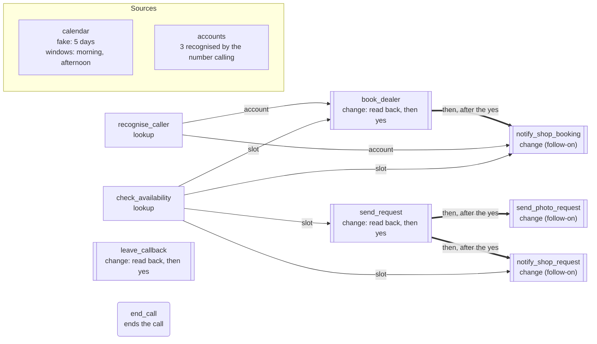
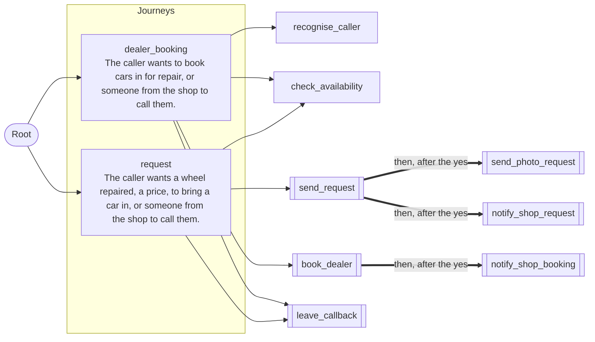

# App map: Example Wheel Works

*Generated from the app's `agent.yaml` by `pnpm app:diagram`: do not edit it by hand. A test fails when this page and the file disagree.*

**This is the structure of the app, not a script for a call.** A model holds the conversation and chooses which action to call; the map shows what each action takes, what runs after a confirmed change, and where a value must come from.

## What the agent can do

| Action | Kind | Takes | Value from |
| --- | --- | --- | --- |
| `recognise_caller` | lookup | nothing | the caller |
| `check_availability` | lookup | `day` | the caller |
| `send_request` | change | `name`, `vehicle`, `wheels`, `damage`, `finish`, `slot`, `callbackNumber`, `textOk`, `notes` | `check_availability` |
| `send_photo_request` | change, a follow-on | `callbackNumber`, `textOk` | the caller |
| `notify_shop_request` | change, a follow-on | `name`, `vehicle`, `wheels`, `damage`, `finish`, `slot`, `callbackNumber`, `textOk`, `notes` | `check_availability` |
| `book_dealer` | change | `account`, `cars`, `vehicles`, `slot` | `recognise_caller`, `check_availability` |
| `notify_shop_booking` | change, a follow-on | `account`, `cars`, `vehicles`, `slot` | `recognise_caller`, `check_availability` |
| `leave_callback` | change | `name`, `callbackNumber`, `about`, `notes` | the caller |

## Actions, follow-ons and sources

A thin arrow is a value the lookup returned: the param must be one of its results on this call. A thick arrow is a follow-on action, run after the caller's yes with the values read back.

## Journeys

Each caller turn, the decision model reads which journey the caller wants; the agent model is offered only that journey's actions (or the root's).

