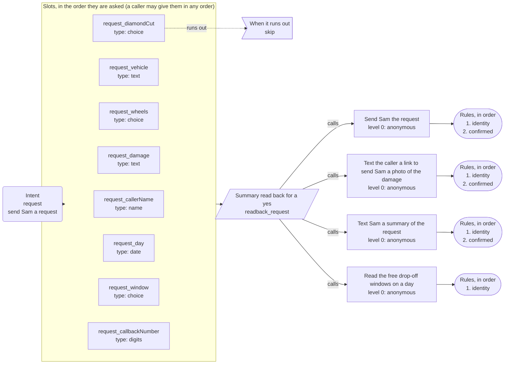
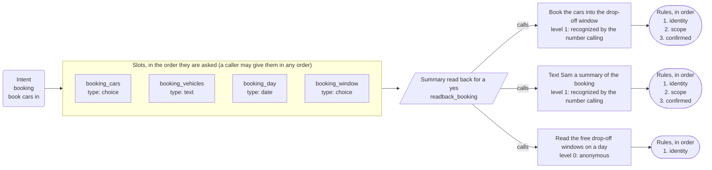
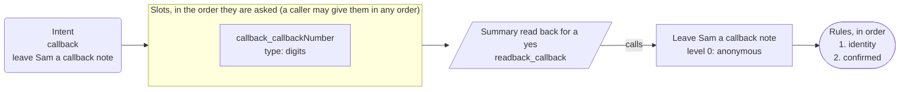

# App map: Example Wheel Works

*Generated from the app's configuration by `pnpm app:diagram`: do not edit it by hand. A test fails when this page and the configuration disagree.*

**This is the structure of the app, not a script for a call.** The dialog is mixed-initiative: a caller may give details in any order, change their mind, answer two questions at once or ask for two things in a row, and the engine follows. The map shows what is connected to what.

## What a caller can ask for

| Intent | Kind | Said as | What happens |
| --- | --- | --- | --- |
| `request` | form | send Sam a request | opens the form, which asks for caller name, vehicle, wheels, damage, diamond cut, day, window, callback number |
| `booking` | form | book cars in | opens the form, which asks for cars, vehicles, day, window |
| `callback` | form | leave Sam a callback note | opens the form, which asks for callback number |
| `agent` | control | speak with someone | handled by the engine |
| `repeat_prompt` | control | hear that again | handled by the engine |
| `done` | control | finish up | handled by the engine |
| `other` | control | something else | handled by the engine |
| `none` | control | nothing | handled by the engine |

## The keypad menu and the lines that are only said

```mermaid
flowchart LR
```

## Send Sam a request

Intent `request` to its slots, the summary, the action and its rules.



## Book cars in

Intent `booking` to its slots, the summary, the action and its rules.



## Leave Sam a callback note

Intent `callback` to its slots, the summary, the action and its rules.



## Dangling references

None: every intent reaches a form or a line, and every action is reached by a form or the identity flow.
