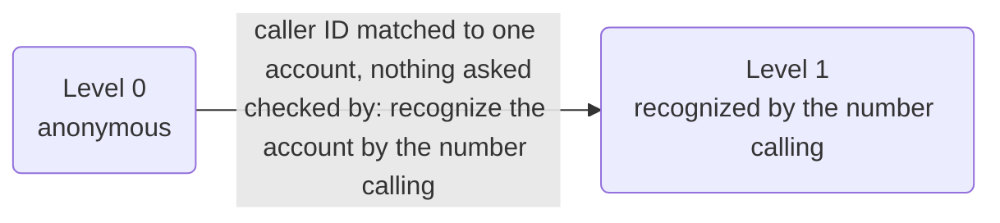

# Policy card: Example Wheel Works

*Generated from `business.yaml` by `pnpm policy:card`: this app is in agent mode, and the engine builds its policy and identity from that file. Do not edit it by hand. Change the file, write the card again, and review the diff. A test fails when this page and the file disagree.*

| File | Config hash |
| --- | --- |
| `business.yaml` | `85d99e828d264ac5a25dd6cd58404209b374c5d12895d511238643b7b445cccc` |

The hash is a SHA-256 of the file's content (comments and layout do not change it); every call's audit record carries the hashes it ran under.

## Defaults

- Anything not listed under Actions is refused.
- The rules of an action run in the order shown, and the first one that fails decides.
- Identifiers in decision lines appear by their last four characters (`...1234`), never in full; a value recorded hidden, by length or never shows not even those.
- A caller has 1 tries at each identity check (the account). After that a person takes the call.
- In traces and the audit a caller's values are recorded as they are said, except: callback number by its last four.

## Identity

| Level | Name | What the caller gives | Checked by |
| --- | --- | --- | --- |
| 0 | anonymous | nothing | |
| 1 | recognized by the number calling | nothing they say: the number they call from, on file for one account | recognize the account by the number calling (`recognizeAccount`) |

- Each level includes the one below it. A caller the number they call from does not recognize is asked nothing to step up: an action that needs level 1 is refused with its line (`identity_not_recognized`), and a form only for recognized callers says its line and offers another (Agent mode, below).
- The identity checks (recognize the account by the number calling, `recognizeAccount`) are for accounts only: a caller not yet verified may use them, and any other party (one who acts for accounts, or anyone else) is refused them before their rules run.
- On a call from a number on file for one account, the account is taken from the match, never said and never asked, and recognized by `recognizeAccount`: in agent mode the caller ID recognizes an account on its own (Agent mode, below).
- The app takes no portal sign-in: every caller proves who they are on the call, and a caller on a channel that signs callers in (a web chat) whose request needs identity goes to a person.

## Agent mode

This app is in agent mode (app.yaml's `mode: agent`): a model, `mercury-3` on inception at `instant` (style.yaml's `agent`), leads the conversation from the business's facts in `business.yaml`, and the engine decides what is done.

- **The conversation is sent to the agent model:** the caller's words as they said them (a number they say included), the line's own replies and the fixed lines said, with what the business may say. No identity factor is sent: the app takes none a caller says. A value the records hide (the callback number by its last four) is sent masked where it is listed as collected, and in the conversation history once the line has understood it.
- **The model proposes; the engine decides.** It never calls a tool. Each value it understands is checked by its field's slot type, and the caller confirms every value at the read-back, said in fixed words, before any action. Every action is decided by the gate, as below.
- **What it may say** is the business's: 17 statements (its claims, services, what it does not offer, where it is, its days and windows), and 0 lines of background it is told never to claim. Its sample replies (4) are sent as examples of tone.

The tools whose results the model sees (business.yaml's `sees`), each called through the gate once its field is filled, its result shown only once the tool's reply check passes, and only the fields that check names, each in a closed form (never free text):

| Field | Tool | Reply check |
| --- | --- | --- |
| day (`request_day`) | read the free drop-off windows on a day (`availability`) | closed form; the model is shown `day` and `windows` |
| day (`booking_day`) | read the free drop-off windows on a day (`availability`) | closed form; the model is shown `day` and `windows` |

### Done only on the caller's answer

Each of these is called after its form's read-back only where the field holds the option named, as the caller answered it and confirmed it in the read-back (business.yaml's `when`, a `oneOf` rule on the action). With any other answer the gate refuses the action, the refusal is audited under the reason named, and the form goes on without it: a caller who did not consent is not, for example, texted.

| Action | Only where | Refused as |
| --- | --- | --- |
| text the caller asking for a photo of the damage, only with their consent (`send_photo_link`), after the request's read-back | text ok (`textOk`) is `yes` | `no-consent` |

Said in fixed words, never worded by a model:

| Line | Said |
| --- | --- |
| `greeting` | Thanks for calling Example Wheel Works. How can I help? |
| `greeting_chat` | Hi, this is Example Wheel Works. What can I help with? |
| `handoff_live_agent` | Someone from the shop will call you back as soon as they can. |
| `goodbye` | Thanks for calling Example Wheel Works. |
| `goodbye_chat` | Thanks for chatting with Example Wheel Works. Goodbye. |
| `booking_for_accounts` | Bookings are for our dealership accounts, but we can take a request instead. |
| `identity_not_recognized` | That's for our dealership accounts, recognized by the number they call from. |
| `price` | We quote every job from a photo, because the price depends on the damage. Once your request is in, we can text you, and you just reply to our text with a photo. Then we'll get back to you with a price and confirm your drop-off. |
| `readback_request` | Here's your request: {request_callerName}, a {request_vehicle} with {request_damage}, on {request_wheels} of its wheels, {request_diamondCut}, hoping to drop it off {request_day} in the {request_window}, {request_textOk} {request_callbackNumber}. Is that right? |
| `done_request` | Thanks, {request_callerName}. {request_textOk} |
| `readback_booking` | So that's {account} dropping off {booking_vehicles}, {booking_cars} in all, on {booking_day} in the {booking_window}. Shall I book it? |
| `done_booking` | You're booked for {booking_day}, in the {booking_window}. Thanks. |
| `readback_callback` | We'll call you back at {callback_callbackNumber}. Is that right? |
| `done_callback` | Thanks. Someone from the shop will call you back as soon as they can. |

### Recognized by the number calling

A call from a number on file for one account (business.yaml's `accounts`) is recognized as that account at level 1 ('recognized by the number calling') by the caller-ID match alone: nothing else is asked. Caller ID is the identifier, never a factor the caller says. **Caller ID can be forged:** a caller who forges an account's number could, as that account, book the cars into the drop-off window (`book`), still only once the caller confirms its read-back; and text the shop a summary of the booking (`notify_owner_booking`), still only once the caller confirms its read-back. That risk is the business's to accept (the agent-mode design's call 14). A number the caller withheld still recognizes the account it is on file for (app.yaml's `callerNumber.withheld: use`, the default); `ignore` treats such a call as one with no number.

`booking` is offered only to a caller recognized by the number calling, so in practice only on a phone call: a chat carries no number to recognize, and a caller on it who asks hears `booking_for_accounts`.

## Who is served and who acts for them

- **account**: the people the app serves. They are verified up the ladder above and may see only their own records.
- No party acts for them on this app.

## What is recorded

What the record of a call keeps of each value the action is sent, where the action's call is recorded: the gate's decision, the trace, the console and the audit. A value is recorded as its slot says or as policy.yaml's `audit` declares, and `check` refuses one that neither covers. Where a rule's line, the action's summary, its own audit rows, the side effects it queues (as recorded) or a downstream service's row for the answer repeat a value that is hidden, shortened or never recorded, it is masked there too.

| Action | Value | Recorded |
| --- | --- | --- |
| Send the shop the request (`request`) | caller name (`callerName`) | as it is |
| Send the shop the request (`request`) | vehicle (`vehicle`) | as it is |
| Send the shop the request (`request`) | wheels (`wheels`) | as it is |
| Send the shop the request (`request`) | damage (`damage`) | as it is |
| Send the shop the request (`request`) | diamond cut (`diamondCut`) | as it is |
| Send the shop the request (`request`) | day (`day`) | as it is |
| Send the shop the request (`request`) | window (`window`) | as it is |
| Send the shop the request (`request`) | callback number (`callbackNumber`) | by its last four characters |
| Send the shop the request (`request`) | text ok (`textOk`) | as it is |
| Text the caller asking for a photo of the damage, only with their consent (`send_photo_link`) | caller name (`callerName`) | as it is |
| Text the caller asking for a photo of the damage, only with their consent (`send_photo_link`) | vehicle (`vehicle`) | as it is |
| Text the caller asking for a photo of the damage, only with their consent (`send_photo_link`) | wheels (`wheels`) | as it is |
| Text the caller asking for a photo of the damage, only with their consent (`send_photo_link`) | damage (`damage`) | as it is |
| Text the caller asking for a photo of the damage, only with their consent (`send_photo_link`) | diamond cut (`diamondCut`) | as it is |
| Text the caller asking for a photo of the damage, only with their consent (`send_photo_link`) | day (`day`) | as it is |
| Text the caller asking for a photo of the damage, only with their consent (`send_photo_link`) | window (`window`) | as it is |
| Text the caller asking for a photo of the damage, only with their consent (`send_photo_link`) | callback number (`callbackNumber`) | by its last four characters |
| Text the caller asking for a photo of the damage, only with their consent (`send_photo_link`) | text ok (`textOk`) | as it is |
| Text the shop a summary of the request (`notify_owner_request`) | caller name (`callerName`) | as it is |
| Text the shop a summary of the request (`notify_owner_request`) | vehicle (`vehicle`) | as it is |
| Text the shop a summary of the request (`notify_owner_request`) | wheels (`wheels`) | as it is |
| Text the shop a summary of the request (`notify_owner_request`) | damage (`damage`) | as it is |
| Text the shop a summary of the request (`notify_owner_request`) | diamond cut (`diamondCut`) | as it is |
| Text the shop a summary of the request (`notify_owner_request`) | day (`day`) | as it is |
| Text the shop a summary of the request (`notify_owner_request`) | window (`window`) | as it is |
| Text the shop a summary of the request (`notify_owner_request`) | callback number (`callbackNumber`) | by its last four characters |
| Text the shop a summary of the request (`notify_owner_request`) | text ok (`textOk`) | as it is |
| Book the cars into the drop-off window (`book`) | account (`account`) | as it is |
| Book the cars into the drop-off window (`book`) | cars (`cars`) | as it is |
| Book the cars into the drop-off window (`book`) | vehicles (`vehicles`) | as it is |
| Book the cars into the drop-off window (`book`) | day (`day`) | as it is |
| Book the cars into the drop-off window (`book`) | window (`window`) | as it is |
| Text the shop a summary of the booking (`notify_owner_booking`) | account (`account`) | as it is |
| Text the shop a summary of the booking (`notify_owner_booking`) | cars (`cars`) | as it is |
| Text the shop a summary of the booking (`notify_owner_booking`) | vehicles (`vehicles`) | as it is |
| Text the shop a summary of the booking (`notify_owner_booking`) | day (`day`) | as it is |
| Text the shop a summary of the booking (`notify_owner_booking`) | window (`window`) | as it is |
| Leave the shop a callback note (`callback`) | callback number (`callbackNumber`) | by its last four characters |
| Read the free drop-off windows on a day (`availability`) | day (`day`) | as it is |
| Find the account the number calling is on file for (`lookupAccount`) | caller number (`callerNumber`) | by its last four characters |
| Recognize the account by the number calling (`recognizeAccount`) | account (`account`) | as it is |

## Actions

One row per action the agent may take. Anything else is refused.

| Action | Level | The gate checks, in order |
| --- | --- | --- |
| **Send the shop the request** `request` | 0 anonymous | 1. any caller may ask, verified or not 2. the caller must confirm exactly these values at the read-back, and nothing else is sent: caller name, vehicle, wheels, damage, diamond cut, day, window, callback number and text ok |
| **Text the caller asking for a photo of the damage, only with their consent** `send_photo_link` | 0 anonymous | 1. any caller may ask, verified or not 2. the caller must confirm exactly these values at the read-back, and nothing else is sent: caller name, vehicle, wheels, damage, diamond cut, day, window, callback number and text ok 3. text ok must be `yes`: anything else is refused (`no-consent`), and a missing value is refused |
| **Text the shop a summary of the request** `notify_owner_request` | 0 anonymous | 1. any caller may ask, verified or not 2. the caller must confirm exactly these values at the read-back, and nothing else is sent: caller name, vehicle, wheels, damage, diamond cut, day, window, callback number and text ok |
| **Book the cars into the drop-off window** `book` | 1 recognized by the number calling | 1. the caller must be at 'recognized by the number calling' or above 2. the account must be the caller's own, or one they act for 3. the caller must confirm exactly these values at the read-back, and nothing else is sent: account, cars, vehicles, day and window |
| **Text the shop a summary of the booking** `notify_owner_booking` | 1 recognized by the number calling | 1. the caller must be at 'recognized by the number calling' or above 2. the account must be the caller's own, or one they act for 3. the caller must confirm exactly these values at the read-back, and nothing else is sent: account, cars, vehicles, day and window |
| **Leave the shop a callback note** `callback` | 0 anonymous | 1. any caller may ask, verified or not 2. the caller must confirm exactly these values at the read-back, and nothing else is sent: callback number |
| **Read the free drop-off windows on a day** `availability` | 0 anonymous | 1. any caller may ask, verified or not |
| **Find the account the number calling is on file for** `lookupAccount` | 0 anonymous | 1. any caller may ask, verified or not 2. caller number must be the number the caller is calling from: any other is refused (`not-caller-number`), as is any number on a call with no caller's number (`no-caller-number`), and a missing number is refused. Caller ID is a hint, never proof of who is calling |
| **Recognize the account by the number calling** `recognizeAccount` | 0 anonymous | 1. only an account, or a caller not yet verified, may use it (any other party is refused) 2. the identity check has not already failed 1 times (after that a person takes the call) |

### Actions by level, with their rules and what each role gets

```mermaid
flowchart LR
  subgraph lv0["Level 0: anonymous"]
    a_request["Send the shop the request<br/>identity · confirmed"]
    a_send_photo_link["Text the caller asking for a photo of the damage, only with their consent<br/>identity · confirmed · oneOf textOk"]
    a_notify_owner_request["Text the shop a summary of the request<br/>identity · confirmed"]
    a_callback["Leave the shop a callback note<br/>identity · confirmed"]
    a_availability["Read the free drop-off windows on a day<br/>identity"]
    a_lookupAccount["Find the account the number calling is on file for<br/>identity · callerNumber callerNumber"]
    a_recognizeAccount["Recognize the account by the number calling<br/>attempts"]
  end
  subgraph lv1["Level 1: recognized by the number calling"]
    a_book["Book the cars into the drop-off window<br/>identity · scope · confirmed"]
    a_notify_owner_booking["Text the shop a summary of the booking<br/>identity · scope · confirmed"]
  end
  lv0 -->|"step up"| lv1
```

