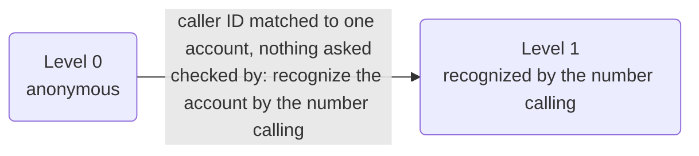
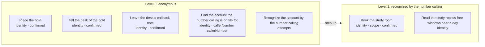

# Policy card: Example Library

*Generated from `business.yaml` by `pnpm policy:card`: this app is in agent mode, and the engine builds its policy and identity from that file. Do not edit it by hand. Change the file, write the card again, and review the diff. A test fails when this page and the file disagree.*

| File | Config hash |
| --- | --- |
| `business.yaml` | `aab20881e29f2cdcaccca4be0111c0799db07c695c75fc4a1a59b02404db0cdf` |

The hash is a SHA-256 of the file's content (comments and layout do not change it); every call's audit record carries the hashes it ran under.

## Defaults

- Anything not listed under Actions is refused.
- The rules of an action run in the order shown, and the first one that fails decides.
- Identifiers in decision lines appear by their last four characters (`...1234`), never in full; a value recorded hidden, by length or never shows not even those.
- A caller has 1 tries at each identity check (the account). After that a person takes the call.
- In traces and the audit a caller's values are recorded as they are said, except: callback by its last four.

## Identity

| Level | Name | What the caller gives | Checked by |
| --- | --- | --- | --- |
| 0 | anonymous | nothing | |
| 1 | recognized by the number calling | nothing they say: the number they call from, on file for one account | recognize the account by the number calling (`recognizeAccount`) |

- Each level includes the one below it. An account below an action's level is asked for what the next level needs; any other caller is refused.
- The identity checks (recognize the account by the number calling, `recognizeAccount`) are for accounts only: a caller not yet verified may use them, and any other party (one who acts for accounts, or anyone else) is refused them before their rules run.
- On a call from a number on file for one account, the account is taken from the match, never said and never asked, and recognized by `recognizeAccount`: in agent mode the caller ID recognizes an account on its own (Agent mode, below).
- The app takes no portal sign-in: every caller proves who they are on the call, and a caller on a channel that signs callers in (a web chat) whose request needs identity goes to a person.

## Agent mode

This app is in agent mode (app.yaml's `mode: agent`): a model, `mercury-3` on inception at `instant` (style.yaml's `agent`), leads the conversation from the business's facts in `business.yaml`, and the engine decides what is done.

- **The conversation is sent to the agent model:** the caller's words, the line's own replies and the fixed lines said, with what the business may say. No identity factor is sent (the app takes none a caller says), and a value the records hide is sent masked as the records mask it.
- **The model proposes; the engine decides.** It never calls a tool. Each value it understands is checked by its field's slot type, and the caller confirms every value at the read-back, said in fixed words, before any action. Every action is decided by the gate, as below.
- **What it may say** is the business's: 9 statements (its claims, services, what it does not offer, where it is, its days and windows), and 1 line of background it is told never to claim. Its sample replies (2) are sent as examples of tone.

The tools whose results the model sees (business.yaml's `sees`), each called through the gate once its field is filled, its result shown only once the tool's reply check passes:

| Field | Tool | Reply check |
| --- | --- | --- |
| booking day (`booking_day`) | read the study room's free windows near a day (`roomAvailability`) | declared |

Said in fixed words, never worded by a model:

| Line | Said |
| --- | --- |
| `greeting` | Thanks for calling Example Library. How can I help? |
| `handoff_live_agent` | I'll have someone from the desk call you back. What's the best number to reach you? |
| `goodbye` | Thanks for calling Example Library. |
| `price` | Fees are explained at the desk, by the person who looks at your account. |
| `readback_request` | Here's the hold: {request_patronName}, {request_copies} of {request_title}, collected {request_day} in the {request_window}, and we'll call you at {request_callbackNumber}. Is that right? |
| `done_request` | Thanks, {request_patronName}. The desk will call you when it's ready. |
| `readback_booking` | So that's the study room for {account}, {booking_people} people, {booking_day} in the {booking_window}. Shall I book it? |
| `done_booking` | You're booked for {booking_day}, {booking_window}. Thanks. |
| `readback_callback` | I'll have Dana call you back at {callback_callbackNumber}. Is that right? |
| `done_callback` | Thanks. Dana will call you back as soon as she can. |

### Recognized by the number calling

A call from a number on file for one account (business.yaml's `accounts`) is recognized as that account at level 1 ('recognized by the number calling') by the caller-ID match alone: nothing else is asked. Caller ID is the identifier, never a factor the caller says. **Caller ID can be forged:** a caller who forges an account's number could, as that account, book the study room (`bookRoom`), still only once the caller confirms its read-back; and read the study room's free windows near a day (`roomAvailability`). That risk is the business's to accept (the agent-mode design's call 14).

## Who is served and who acts for them

- **account**: the people the app serves. They are verified up the ladder above and may see only their own records.
- No party acts for them on this app.

## What is recorded

What the record of a call keeps of each value the action is sent, where the action's call is recorded: the gate's decision, the trace, the console and the audit. A value is recorded as its slot says or as policy.yaml's `audit` declares, and `check` refuses one that neither covers. Where a rule's line, the action's summary, its own audit rows, the side effects it queues (as recorded) or a downstream service's row for the answer repeat a value that is hidden, shortened or never recorded, it is masked there too.

| Action | Value | Recorded |
| --- | --- | --- |
| Place the hold (`placeHold`) | patron name (`patronName`) | as it is |
| Place the hold (`placeHold`) | title (`title`) | as it is |
| Place the hold (`placeHold`) | copies (`copies`) | as it is |
| Place the hold (`placeHold`) | format (`format`) | as it is |
| Place the hold (`placeHold`) | day (`day`) | as it is |
| Place the hold (`placeHold`) | window (`window`) | as it is |
| Place the hold (`placeHold`) | callback number (`callbackNumber`) | by its last four characters |
| Tell the desk of the hold (`notifyDesk`) | patron name (`patronName`) | as it is |
| Tell the desk of the hold (`notifyDesk`) | title (`title`) | as it is |
| Tell the desk of the hold (`notifyDesk`) | copies (`copies`) | as it is |
| Tell the desk of the hold (`notifyDesk`) | format (`format`) | as it is |
| Tell the desk of the hold (`notifyDesk`) | day (`day`) | as it is |
| Tell the desk of the hold (`notifyDesk`) | window (`window`) | as it is |
| Tell the desk of the hold (`notifyDesk`) | callback number (`callbackNumber`) | by its last four characters |
| Book the study room (`bookRoom`) | account (`account`) | as it is |
| Book the study room (`bookRoom`) | people (`people`) | as it is |
| Book the study room (`bookRoom`) | day (`day`) | as it is |
| Book the study room (`bookRoom`) | window (`window`) | as it is |
| Leave the desk a callback note (`noteCallback`) | callback number (`callbackNumber`) | by its last four characters |
| Read the study room's free windows near a day (`roomAvailability`) | day (`day`) | as it is |
| Find the account the number calling is on file for (`lookupAccount`) | caller number (`callerNumber`) | by its last four characters |
| Recognize the account by the number calling (`recognizeAccount`) | account (`account`) | as it is |

## Actions

One row per action the agent may take. Anything else is refused.

| Action | Level | The gate checks, in order |
| --- | --- | --- |
| **Place the hold** `placeHold` | 0 anonymous | 1. any caller may ask, verified or not 2. the caller must confirm exactly these values at the read-back, and nothing else is sent: patron name, title, copies, format, day, window and callback number |
| **Tell the desk of the hold** `notifyDesk` | 0 anonymous | 1. any caller may ask, verified or not 2. the caller must confirm exactly these values at the read-back, and nothing else is sent: patron name, title, copies, format, day, window and callback number |
| **Book the study room** `bookRoom` | 1 recognized by the number calling | 1. the caller must be at 'recognized by the number calling' or above 2. the account must be the caller's own, or one they act for 3. the caller must confirm exactly these values at the read-back, and nothing else is sent: account, people, day and window |
| **Leave the desk a callback note** `noteCallback` | 0 anonymous | 1. any caller may ask, verified or not 2. the caller must confirm exactly these values at the read-back, and nothing else is sent: callback number |
| **Read the study room's free windows near a day** `roomAvailability` | 1 recognized by the number calling | 1. the caller must be at 'recognized by the number calling' or above |
| **Find the account the number calling is on file for** `lookupAccount` | 0 anonymous | 1. any caller may ask, verified or not 2. caller number must be the number the caller is calling from: any other is refused (`not-caller-number`), as is any number on a call with no caller's number (`no-caller-number`), and a missing number is refused. Caller ID is a hint, never proof of who is calling |
| **Recognize the account by the number calling** `recognizeAccount` | 0 anonymous | 1. only an account, or a caller not yet verified, may use it (any other party is refused) 2. the identity check has not already failed 1 times (after that a person takes the call) |

### Actions by level, with their rules and what each role gets

