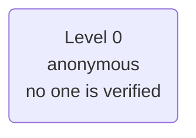
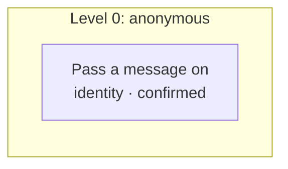

# Policy card: Example Office

*Generated from `policy.yaml` and `identity.yaml`, and the lines a model words from `prompts.yaml` and `forms.yaml`, by `pnpm policy:card`: do not edit it by hand. Change the files, write the card again, and review the diff. A test fails when this page and the files disagree.*

| File | Config hash |
| --- | --- |
| `policy.yaml` | `e16b4b5e11aeaf063cb95f1a028ccee43a91b102aeb3dcc976120001c1e1002d` |
| `identity.yaml` | none: this app verifies no one |

The hash is a SHA-256 of the file's content (comments and layout do not change it); every call's audit record carries the hashes it ran under.

## Defaults

- Anything not listed under Actions is refused.
- The rules of an action run in the order shown, and the first one that fails decides.
- Identifiers in decision lines appear by their last four characters (`...1234`), never in full; a value recorded hidden, by length or never shows not even those.
- In traces and the audit a caller's values are recorded as they are said, except: phone by its last four.

## Identity

This app verifies no one. Every caller stays anonymous (level 0), so every action is at level 0.

## Who is served and who acts for them

No one is verified, so the app has no subjects and no one acts for them.

## What is recorded

What the record of a call keeps of each value the action is sent: the gate's decision, the trace, the console and the audit. A value is recorded as its slot says or as policy.yaml's `audit` declares, and `check` refuses one that neither covers. Where a rule's line, the action's summary, its own audit rows, the side effects it queues (as recorded) or a downstream service's row for the answer repeat a value that is hidden, shortened or never recorded, it is masked there too.

| Action | Value | Recorded |
| --- | --- | --- |
| Pass a message on (`leaveMessage`) | for (`recipient`) | as it is |
| Pass a message on (`leaveMessage`) | from (`caller`) | by its length only |
| Pass a message on (`leaveMessage`) | phone (`phone`) | by its last four characters |
| Pass a message on (`leaveMessage`) | message (`message`) | by its length only |

## Lines a model words

These lines are worded by a model for the moment (generated wording). Each is checked before anyone hears it: every value it must carry is there word for word; it names no number, amount, date or ordinal it was not given (a figure the caller said only in an acknowledgement of it), and no capitalized word it was not given; it adds no negation and drops none from what it restates, and names no other value of an item's own slot in its place; it keeps to its word budget and asks one question only where its fixed text does, a question a yes or a no settles kept word for word; it avoids the phrases style.yaml lists; and the decision model, given the line, its goal and its fixed text with the caller's words apart, finds it does nothing beyond its goal and states nothing of the caller's words as the agent's own. Collected content is screened for an injection again before a line is worded from it. When a check fails, the model is slow or errs, or the caller's words were flagged, its fixed text is said instead. The model is sent the line's values as its fixed text would say them (those a tool filled in among them), the caller's words on the turn, quoted (never after a question whose answer the records mask), and the content it may summarize; never an identity factor, a value the records hide whole, the transcript, or anything else a tool returned. Every other line is said word for word.

| Line | Fixed text | Goal | Generated | Carries word for word | Sent whole, though recorded masked | May summarize |
| --- | --- | --- | --- | --- | --- | --- |
| `confirm_take_message` | For {recipient}, from {caller}, call back on {phone}. Your message: {message}. Shall I pass it on? | Read back who the message is for, who it is from and the number to call, then a short summary of the message in your own words, and ask whether to pass it on. | the first time it is said | `{recipient}`, `{caller}`, `{phone}` | `{phone}` | `{message}`, a value the caller confirms |
| `ask_recipient` | Who is the message for, Dana Reyes or Lee Park? | Ask who the message is for, Dana Reyes or Lee Park; briefly acknowledge what the caller just said. | every situation (its form `take_message`) | nothing | nothing | nothing |
| `ask_recipient_retry` | Sorry, is the message for Dana Reyes or Lee Park? | Ask again, kindly, whether the message is for Dana Reyes or Lee Park. | every situation (its form `take_message`) | nothing | nothing | nothing |
| `ask_caller` | And who is the message from? | Ask for the caller's name. | every situation (its form `take_message`) | nothing | nothing | nothing |
| `ask_caller_retry` | Sorry, what name should I give? | Say what the fixed line says, in words that fit this moment. | every situation (its form `take_message`) | nothing | nothing | nothing |
| `ask_phone` | What's the best number to call you back on? | Ask for the number to call the caller back on. | every situation (its form `take_message`) | nothing | nothing | nothing |
| `ask_phone_retry` | Sorry, what's the ten-digit number to call you back on? | Say what the fixed line says, in words that fit this moment. | every situation (its form `take_message`) | nothing | nothing | nothing |
| `ask_message` | What's the message? | Ask the caller for their message; you may acknowledge their name. | every situation (its form `take_message`) | nothing | nothing | nothing |
| `ask_message_retry` | Sorry, what message should I pass on? | Say what the fixed line says, in words that fit this moment. | every situation (its form `take_message`) | nothing | nothing | nothing |

Prescribed lines (`prescribed: true`): always said word for word, never generated.

| Line | Text |
| --- | --- |
| `greeting` | Thanks for calling Example Office. This call may be recorded. I can take a message. How can I help? |
| `message_taken` | Thanks, {caller}. Your message for {recipient} has been passed on. Your reference is {ref}. |

## Actions

One row per action the agent may take. Anything else is refused.

| Action | Level | The gate checks, in order |
| --- | --- | --- |
| **Pass a message on** `leaveMessage` | 0 anonymous | 1. any caller may ask, verified or not 2. the caller must confirm exactly these values at the read-back, and nothing else is sent: for, from, phone and message (the read-back is generated and may summarize message; the values confirmed and sent are the ones kept, word for word, and the caller may ask to hear them so) |

### Actions by level, with their rules and what each role gets

