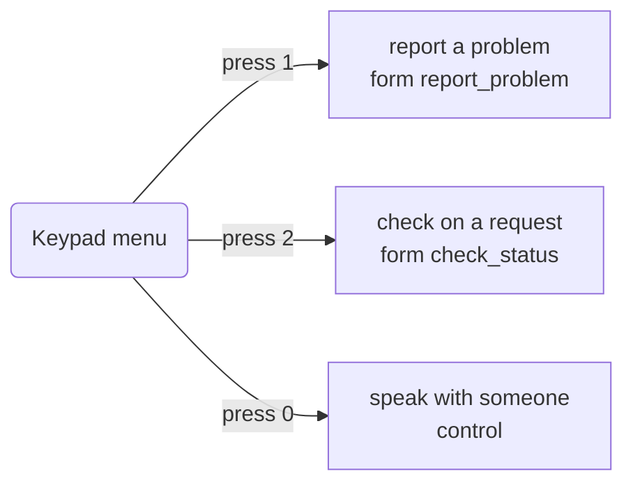
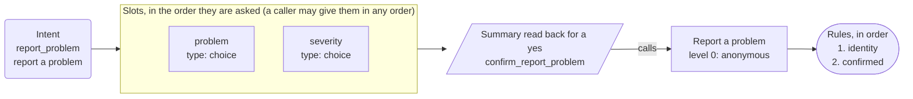
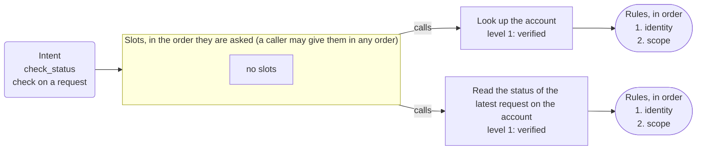
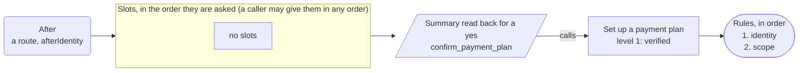
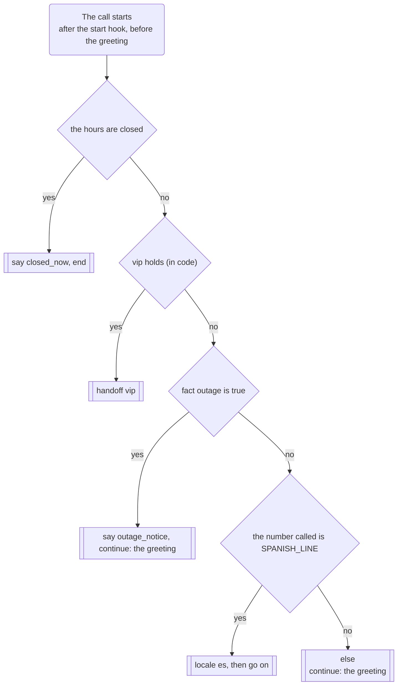
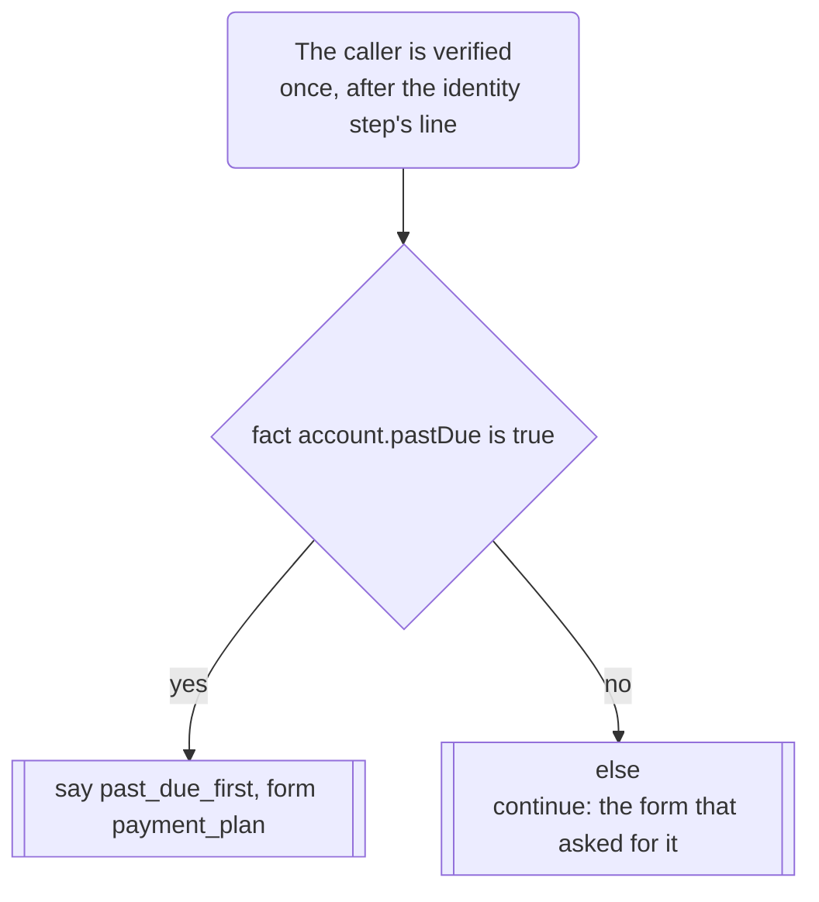
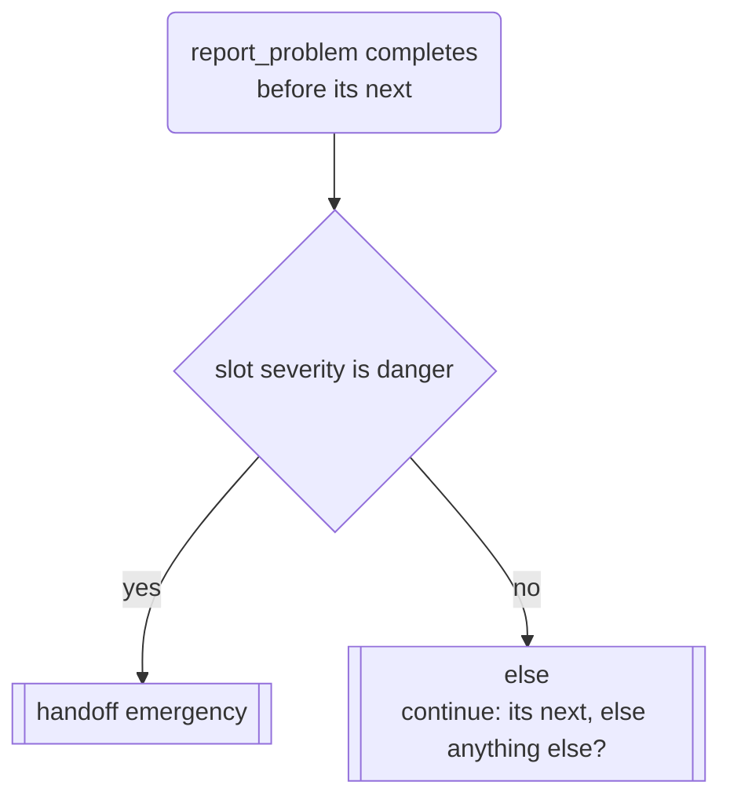
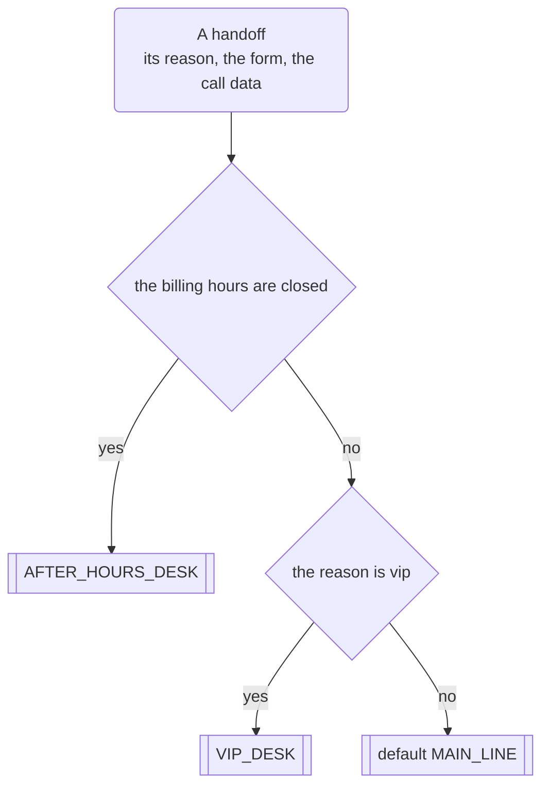

# App map: Example Service Line

*Generated from the app's configuration by `pnpm app:diagram`: do not edit it by hand. A test fails when this page and the configuration disagree.*

**This is the structure of the app, not a script for a call.** The dialog is mixed-initiative: a caller may give details in any order, change their mind, answer two questions at once or ask for two things in a row, and the engine follows. The map shows what is connected to what.

## What a caller can ask for

| Intent | Kind | Said as | What happens |
| --- | --- | --- | --- |
| `report_problem` | form | report a problem | opens the form, which asks for problem, danger |
| `check_status` | form | check on a request | opens the form, which asks for nothing |
| `agent` | control | speak with someone | handled by the engine |
| `repeat_prompt` | control | hear that again | handled by the engine |
| `done` | control | finish up | handled by the engine |
| `other` | control | something else | handled by the engine |
| `none` | control | nothing | handled by the engine |

## The keypad menu and the lines that are only said

## Report a problem

Intent `report_problem` to its slots, the summary, the action and its rules.

## Check on a request

Intent `check_status` to its slots, the summary, the action and its rules.

## Payment plan

After a route (afterIdentity): the internal form `payment_plan`, its slots, the summary, the action and its rules.

## Routes

What the call does at its start, once the caller is verified, and after a form: the rules at each point are tried in order, the first whose conditions all hold is taken, and the else last. What the caller says still decides every other turn.

The start hook runs first, as every call starts, and calls `lookupNotices`.

### At the start of a call

### Once the caller is verified

### After Report a problem

## Where a handoff goes

The transfer targets, tried in order: the first whose conditions all hold is taken, else the default. Each dials the number or SIP address in its environment variable; the headers go only to a SIP address, the chat data only on a web chat.

## Dangling references

None: every intent reaches a form or a line, and every action is reached by a form or the identity flow.
